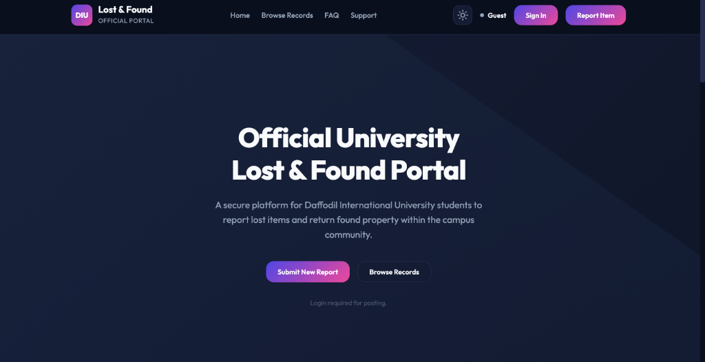
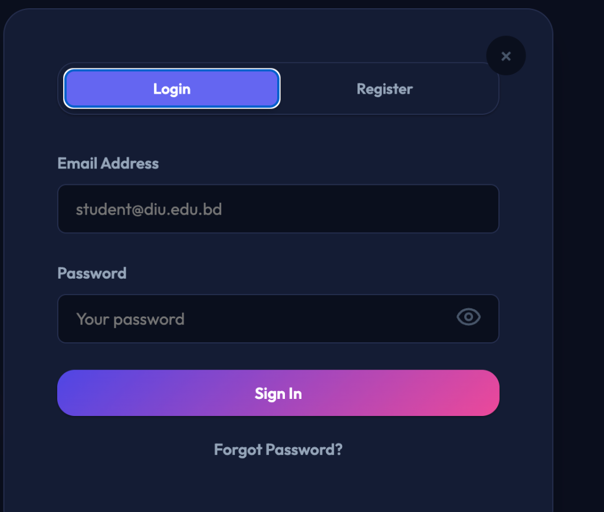
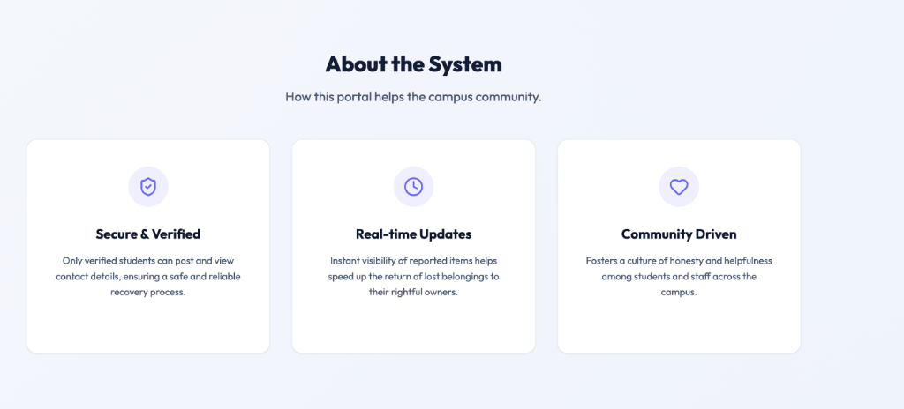
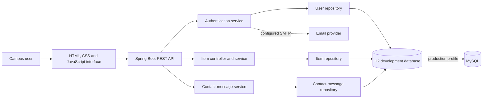
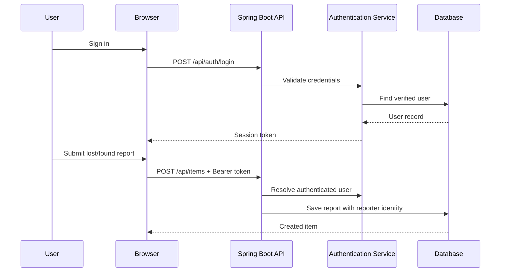
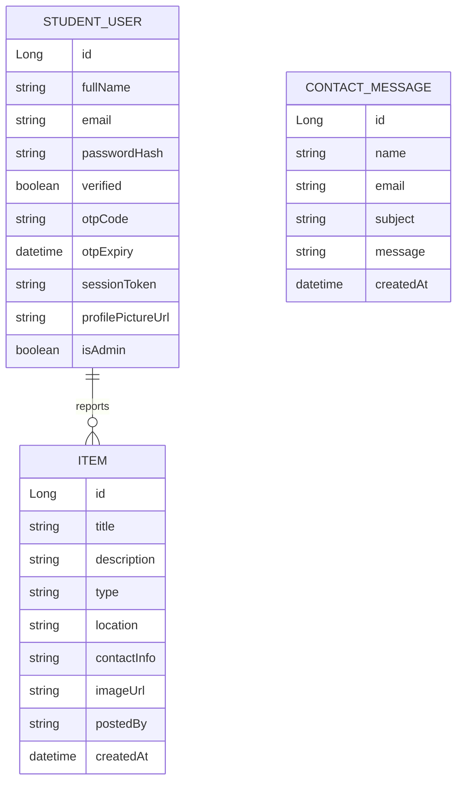

# University Lost & Found Portal

[](https://openjdk.org/)
[](https://spring.io/projects/spring-boot)
[](https://www.mysql.com/)

A full-stack campus lost-and-found prototype that allows university community members to publish lost or found item reports, browse searchable records, inspect item details, and manage account profiles through a responsive web interface backed by a Spring Boot REST API.


## Problem and Motivation

Lost-property information is often scattered across social-media posts, informal messages, and physical notice boards. Important reports quickly disappear, while finders and owners have no consistent place to coordinate.

This portal explores a centralized workflow where users can:

- Publish structured lost and found reports
- Browse reports by category
- Search and sort recent records
- Protect contact details behind an account interface
- Manage obsolete or resolved records through controlled deletion

## Implemented Features

### Item discovery

- Public lost-and-found listing
- Lost/found category filtering
- Newest/oldest sorting
- Individual item-detail view
- Location, report date, description, reporter, and image-link fields
- Responsive card-based layout

### Authenticated reporting

- DIU-domain email-format validation during registration
- Registration and verification workflow
- Login with server-issued session tokens
- Authenticated item submission
- Automatic association between a report and its submitting user
- Contact-information fallback to the authenticated email

### Account management

- User profile retrieval and editing
- Profile-picture URL support
- Password-change interface
- Password-recovery workflow scaffold
- Light and dark themes

### Administration and moderation

- Administrator role stored in the user record
- Separate administrator login page
- Backend authorization allowing an administrator or original reporter to delete an item
- Contact-message persistence

### Persistence and deployment

- Spring Data JPA repositories
- File-based H2 database for zero-configuration local development
- Optional MySQL dependency and configuration template
- Render deployment descriptor
- Static frontend and Spring Boot API in one repository

## Screenshots

### Landing and hero section



### Authentication interface



### About the platform



## System Architecture



## Request Flow



## Technology Stack

| Layer | Technology | Responsibility |
|---|---|---|
| Backend | Java 17, Spring Boot 3.5 | REST API and application configuration |
| Web | Spring MVC | Controllers, routing, and static-file delivery |
| Persistence | Spring Data JPA, Hibernate | Entity mapping and repository access |
| Development database | H2 | Zero-configuration local persistence |
| Optional database | MySQL | External relational deployment target |
| Mail integration | Spring Mail | Configurable OTP-email delivery service |
| Frontend | HTML5, CSS3, JavaScript | Responsive interface and API communication |
| Icons | Lucide | Interface iconography |
| Deployment | Render, Vercel configuration | Backend/static deployment experiments |

## Repository Structure

```text
University-lost-and-found-portal/
├── src/
│   ├── main/
│   │   ├── java/com/anushka/university_lost_and_found/
│   │   │   ├── config/          # CORS, seed data and web routes
│   │   │   ├── controller/      # Authentication, items and contact endpoints
│   │   │   ├── exception/       # API exception handling
│   │   │   ├── model/           # JPA entities
│   │   │   ├── repository/      # Spring Data repositories
│   │   │   ├── service/         # Application and authentication logic
│   │   │   └── UniversityLosAndFoundApplication.java
│   │   └── resources/
│   │       ├── static/          # HTML, CSS, JavaScript and screenshots
│   │       └── application.properties
│   └── test/                    # Spring Boot test source
├── mvnw
├── mvnw.cmd
├── pom.xml
├── render.yaml
├── vercel.json
└── README.md
```

## Core Data Model



## API Overview

| Method | Endpoint | Purpose | Intended access |
|---|---|---|---|
| `POST` | `/api/auth/register` | Begin account registration | Public |
| `POST` | `/api/auth/verify-otp` | Verify a registration code | Public |
| `POST` | `/api/auth/login` | Authenticate and obtain a token | Public |
| `GET` | `/api/auth/profile` | Retrieve current profile | Authenticated |
| `PUT` | `/api/auth/profile` | Update current profile | Authenticated |
| `POST` | `/api/auth/change-password` | Change current password | Authenticated |
| `POST` | `/api/auth/forgot-password` | Begin password recovery | Public |
| `POST` | `/api/auth/reset-password` | Complete password recovery | Public |
| `GET` | `/api/items` | List or filter reports | Public |
| `GET` | `/api/items/:id` | Retrieve one report | Currently public |
| `POST` | `/api/items` | Create a report | Authenticated |
| `DELETE` | `/api/items/:id` | Delete an owned/moderated report | Owner or administrator |
| `POST` | `/api/contact` | Submit a contact message | Public |

## Local Development

### Prerequisites

- Java 17 or newer
- Internet access for the first Maven dependency download
- Optional MySQL server for an external database configuration

### 1. Clone the repository

```bash
git clone https://github.com/anushka06onu/University-lost-and-found-portal.git
cd University-lost-and-found-portal
```

### 2. Run with the H2 development database

macOS or Linux:

```bash
./mvnw spring-boot:run
```

Windows:

```powershell
mvnw.cmd spring-boot:run
```

Open `http://localhost:8080`.

### 3. Run the tests

```bash
./mvnw test
```

### 4. Create a production package

```bash
./mvnw clean package
java -jar target/university-lost-and-found-portal-0.0.1-SNAPSHOT.jar
```

## Configuration

The current repository defaults to file-based H2 storage. For an external database and real email delivery, use environment-specific configuration rather than committing credentials.

Example variables:

```env
PORT=8080
DB_URL=jdbc:mysql://localhost:3306/lost_found_db
DB_USERNAME=your_database_user
DB_PASSWORD=your_database_password
MAIL_USERNAME=your_smtp_username
MAIL_PASSWORD=your_smtp_app_password
MAIL_FROM=your_sender_address
```

The MySQL properties in `application.properties` must be activated through a dedicated production profile before these database variables take effect.

## Image Handling

The API currently accepts validated Cloudinary-hosted image URLs. The browser file-selection workflow does **not** upload the selected file: it substitutes a random demonstration image. Therefore, the current feature should be described as prototype image support, not a completed Cloudinary upload integration.


## Current Limitations


- OTP generation uses a non-cryptographic random-number generator.
- Passwords use unsalted SHA-256 rather than an adaptive password hasher.
- The seed initializer contains a hard-coded administrator account and password.
- Registering an existing email currently updates the existing account instead of rejecting the registration.
- Session tokens have no explicit expiration or logout invalidation workflow.
- H2 Console, SQL logging, and wildcard CORS are enabled in the default configuration.
- Browser-selected images are replaced by demonstration images rather than uploaded.
- The contact endpoint has no authentication, validation, or anti-spam protection.
- Item status, ownership claims, handover evidence, and resolved-item workflows are not modeled.
- Automated coverage currently contains only a minimal context test.

## Production Hardening Checklist

- Reject registration when the normalized email already exists
- Hash passwords with BCrypt or Argon2 through Spring Security
- Generate OTPs using `SecureRandom`, store only a protected representation, and enforce expiry and attempt limits
- Never return OTPs in API responses or write them to production logs
- Send verification and reset codes through the configured mail service
- Remove the hard-coded administrator and create administrators through a controlled setup process
- Add expiring sessions, logout, revocation, and password-change invalidation
- Return public item DTOs that exclude contact details
- Require authentication for contact-detail access
- Disable H2 Console and SQL logging outside the development profile
- Restrict CORS to approved frontend origins
- Add request DTOs and Jakarta Bean Validation
- Implement real managed image upload
- Add rate limiting and contact-form spam controls
- Use a durable production database rather than file-based H2 on ephemeral hosting
- Add unit, integration, authorization, and API tests


## Author

Developed by **Fateha Hossain Anushka**.

- [GitHub](https://github.com/anushka06onu)
- [Portfolio](https://fatehahossainanushka.vercel.app/)

## License

No license file is currently included. Add an explicit license before describing the repository as open source or granting reuse rights.
